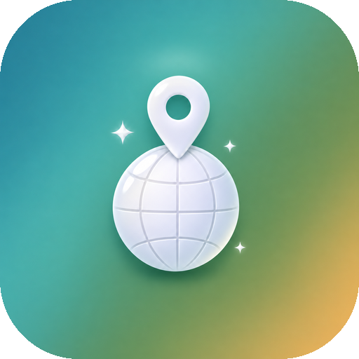

<p align="center">
  
</p>

<h1 align="center">MyExperience</h1>

<p align="center"><em>Ogni viaggio, una storia.</em></p>

<p align="center">
  <a href="https://github.com/carellice/MyExperience/releases/latest"></a>
  
</p>

MyExperience è un diario di viaggio per Android: un globo 3D con i luoghi che hai visitato, album-diario con foto, video e blocchi di testo, e la pianificazione dei prossimi viaggi.

## Funzionalità

- 🌍 Globo 3D interattivo con i tuoi luoghi, personalizzabile (luce, nuvole, riflessi, stelle…)
- 🏅 Bollini da collezione dei patrimoni UNESCO italiani: si raccolgono a meno di 200 m dal sito
- 📔 Album-diario per ogni viaggio, con temi, foto e video
- 🚐 Album "on the road" con più tappe, mappa e percorso disegnato nel diario
- 🧳 Pianificazione dei viaggi con tappe e cose da fare: a viaggio concluso diventa da solo un unico album
- 👤 Profilo con statistiche (paesi, giorni, foto, video)
- 🔄 Aggiornamento in-app direttamente dalle GitHub Releases

## Installazione

1. Scarica l'APK dall'[ultima release](https://github.com/carellice/MyExperience/releases/latest).
2. Aprilo sul telefono e consenti l'installazione da origini sconosciute.

Gli aggiornamenti successivi arrivano dall'app: all'avvio controlla se c'è una nuova release, e puoi controllare a mano da **Profilo → Controlla aggiornamenti**.

## Build

Requisiti: JDK 17+, Android SDK (platform 35), Gradle 8.9+.

```bash
./build-apk.sh
```

L'APK firmato finisce in `dist/`. La firma release usa `~/.android/myexperience-signing/signing.properties` (fuori dal repo); se manca, si usa la chiave di debug.

## Pubblicare una nuova versione

1. Alza `versionCode` e `versionName` in `app/build.gradle.kts`.
2. Lancia:

```bash
./release.sh "Novità di questa versione"
```

Lo script crea la release `vX.Y.Z` con l'APK allegato. Le app installate la vedono al successivo avvio.

## Crediti

Immagini della Terra: [Solar System Scope](https://www.solarsystemscope.com/textures/) (CC BY 4.0) · Mappe © Esri, OpenStreetMap contributors.
